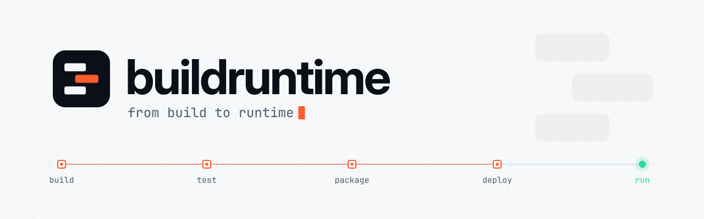

<picture>
  <source media="(prefers-color-scheme: dark)" srcset="assets/brand/banner-dark.svg">
  <source media="(prefers-color-scheme: light)" srcset="assets/brand/banner-light.svg">
  
</picture>

 

**Developer tooling for everything between `git push` and a healthy process in production.**

build&nbsp;&nbsp;·&nbsp;&nbsp;test&nbsp;&nbsp;·&nbsp;&nbsp;package&nbsp;&nbsp;·&nbsp;&nbsp;deploy&nbsp;&nbsp;·&nbsp;&nbsp;run

 

## About

**Buildruntime** works on the part of software delivery most teams only notice when it breaks: the path from source code to a running service. We build tools that make that path **fast**, **reproducible** and **observable**, so engineers spend their time on the product instead of the pipeline.

## What we focus on

<table>
  <tr>
    <td width="33%" valign="top">
      <h3>Build</h3>
      Fast, hermetic builds with caching you can trust. Same inputs, same outputs, on every machine.
    </td>
    <td width="33%" valign="top">
      <h3>Ship</h3>
      Packaging and delivery pipelines that are predictable, reviewable and boring in the best way.
    </td>
    <td width="33%" valign="top">
      <h3>Run</h3>
      Runtime environments that are easy to operate and easy to see into once they are live.
    </td>
  </tr>
</table>

## Principles

- **Reproducible by default.** A build is a function of its inputs, never of the machine it ran on.
- **Fast feedback.** Every second shaved off the loop is time given back to the people writing the code.
- **Observable.** If it runs, you should be able to see what it is doing and why.
- **Small, sharp tools.** Composable pieces that do one job well, instead of one platform that does everything.
- **Built in the open.** Clear docs, clear changelogs, and decisions you can read.

## Projects

> [!NOTE]
> The first public repositories are being prepared. They will be listed here as they ship.

<!--
Add each project as it goes public:

| Project | What it does | Status |
| --- | --- | --- |
| [name](https://github.com/buildruntime/name) | One-line description. | `alpha` |
-->

## Follow along

- Follow [@buildruntime](https://github.com/buildruntime) on GitHub to see new repositories as they are released.
- Watch individual repositories for releases once they are public.

 

<picture>
  <source media="(prefers-color-scheme: dark)" srcset="assets/brand/logo-horizontal-dark.svg">
  <source media="(prefers-color-scheme: light)" srcset="assets/brand/logo-horizontal-light.svg">
  
</picture>

from build to runtime

