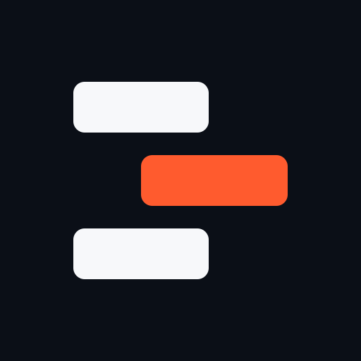
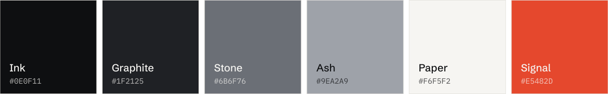

# Buildruntime brand guidelines

<picture>
  <source media="(prefers-color-scheme: dark)" srcset="../assets/brand/logo-horizontal-dark.svg">
  
</picture>

The reference for how Buildruntime looks and sounds. Every file in
[`assets/brand/`](../assets/brand) is generated by [`generate.py`](generate.py);
change the tokens there and regenerate instead of editing SVGs by hand.

## Direction

Quiet, exact and durable. The identity is carried by typography, proportion and
space, not by decoration. If an element does not help someone read or recognise
the brand, it is left out: no gradients, glows, grids, illustrations or badges.

## Name

- **Buildruntime** in running text: one word, capital B only.
- **buildruntime** in the wordmark, URLs, package and CLI names.
- Never "BuildRuntime", "Build Runtime" or "BR".

## Line

> Software engineering, from build to runtime.

The first half says what we do; the second says how far we take it. Set the
second half in the secondary text colour, as in the banner.

## Mark

&nbsp;&nbsp;&nbsp;
&nbsp;&nbsp;&nbsp;


A lowercase **b** drawn in two parts. The stem is the structure, what gets built.
The bowl is the system in motion, what runs. The gap between them is the interface,
and it is the one detail that makes the mark ours. Keep it open at every size.

- Grid: 64 × 64. Stroke 10, gap 5. The bowl is a true semicircle and overshoots the
  baseline by 0.75 so it looks optically aligned with the flat stem.
- In the lockup the mark is exactly the height of the wordmark's ascenders and sits
  on its baseline. The space between them is 0.42 × the mark height.
- Clear space: the mark's stroke width on every side (larger is better).
- Minimum size: 14 px tall for the mark, 88 px wide for the lockup.
- The mark is always a single colour: Ink on light, Paper on dark.

### Files

| File | Use |
| :-- | :-- |
| `logo-horizontal-light.svg` / `-dark.svg` | Default logo. Mark + wordmark. |
| `wordmark-light.svg` / `-dark.svg` | Wordmark alone, when the mark is already nearby. |
| `logo-mark-on-light.svg` / `-on-dark.svg` | Mark alone, transparent background. |
| `logo-mark.svg` | Mark on an Ink tile. App icons and favicons. |
| `avatar.svg` / `avatar.png` | 512 × 512 profile picture, safe inside a circular crop. |
| `banner-light.svg` / `-dark.svg` | README header. Use both through `<picture>`. |
| `social-preview.svg` / `.png` | 1280 × 640 repository social preview. |
| `palette.svg` | Colour reference. |

### Don't

- Close the gap, round the stem, or change the stroke weight.
- Put the mark in colour, outline it, or add effects.
- Type the wordmark in a live font. Use the outlined files.
- Stack the wordmark under the mark. The lockup is horizontal only.

## Colour



| Token | Hex | Role |
| :-- | :-- | :-- |
| Ink | `#0E0F11` | Text on light. Dark backgrounds. The mark. |
| Graphite | `#1F2125` | Raised surfaces on dark. |
| Stone | `#6B6F76` | Secondary text on light (4.6:1 on Paper). |
| Ash | `#9EA2A9` | Secondary text on dark (7.5:1 on Ink). |
| Rule light / dark | `#E3E2DE` / `#26282C` | Hairlines and borders. |
| Paper | `#F6F5F2` | Light backgrounds. Text on dark. |
| Signal | `#E5482D` | The only accent. Links, focus and the single thing on a page that needs attention. |

The identity is deliberately close to monochrome. Signal is not used in the logo,
banners or avatar; it is reserved for interface and documentation, and appears at
most once per view. It measures 3.6:1 on Paper and 4.8:1 on Ink, so on light backgrounds use it only for text at 18 px and up.

## Typography

| Role | Typeface | Setting |
| :-- | :-- | :-- |
| Wordmark | Schibsted Grotesk SemiBold | Lowercase, tracking −2%. |
| Headlines | Schibsted Grotesk Medium | Sentence case, tracking −2.8%, leading 1.06. |
| Body | Schibsted Grotesk Regular | Default tracking. |
| Code and data | IBM Plex Mono Regular | Hex values, versions, commands. |

Both are licensed under the SIL Open Font License 1.1. On GitHub, body text uses
the reader's system font; brand type appears only inside the outlined images.

## Writing

- Say what something does, plainly. No superlatives, no "revolutionary", no "seamless".
- Only state what can be checked. No invented numbers, customers or awards.
- Short sentences. Sentence-case headings. Few em dashes.
- No emoji in headings, and no badges unless they report something real, such as a build status or a version.

## Regenerating

```bash
pip install fonttools uharfbuzz brotli
npm i --prefix brand/.cache @fontsource/schibsted-grotesk @fontsource/ibm-plex-mono
python3 brand/generate.py
node brand/export-png.js
```
